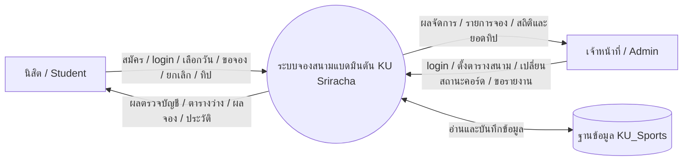

# Data Flow Diagram (DFD)

แผนภาพนี้แสดงการไหลของข้อมูลระหว่างนิสิต เจ้าหน้าที่ กระบวนการของระบบ และตารางใน SQL Server ไม่ได้แสดงลำดับหน้าจอแบบละเอียด

## Context Diagram (Level 0)



## DFD Level 1

```mermaid
flowchart LR
    S[นิสิต]
    A[เจ้าหน้าที่]
    P1((1. สมัครและยืนยันตัวตน))
    P2((2. ตรวจวันและแสดงความพร้อม))
    P3((3. ตรวจสอบและสร้างการจอง))
    P4((4. ดูประวัติและยกเลิก))
    P5((5. บันทึกเงินสนับสนุน))
    P6((6. จัดการตารางและคอร์ด))
    P7((7. สรุปรายงานและ audit))
    D1[(D1 STUDENTS)]
    D2[(D2 COURTS)]
    D3[(D3 TIME_SLOTS)]
    D4[(D4 FACILITY_SCHEDULE)]
    D5[(D5 BOOKINGS)]
    D6[(D6 DONATIONS)]
    D7[(D7 BOOKING_LOGS)]
    D8[(D8 STAFF_USERS)]

    S -->|รหัสนิสิต 10 หลัก ชื่อ รหัสผ่าน| P1
    P1 <-->|ข้อมูลบัญชี / PasswordHash / IsActive| D1
    P1 -->|ผลสมัคร / session นิสิต| S

    S -->|วันที่ต้องการจอง| P2
    P2 <-->|สถานะเปิดปิดและกิจกรรมของวัน| D4
    P2 <-->|ชื่อและสถานะคอร์ด| D2
    P2 <-->|ช่วงเวลาและสถานะ| D3
    P2 <-->|รายการจองที่ยัง BOOKED| D5
    P2 -->|วันเปิดหรือปิด / คอร์ดและ slot ว่าง| S

    S -->|คอร์ด slot วัน และรหัสผู้เล่นร่วม| P3
    P3 -->|ตรวจสิทธิ์ผู้จองและผู้เล่นร่วม| D1
    P3 -->|ตรวจคอร์ดและ slot ที่ active| D2
    P3 -->|ตรวจว่าวันเปิดและไม่มี Event| D4
    P3 -->|ตรวจการจองซ้ำและบันทึกรายการ| D5
    P3 -->|บันทึก CREATED ผ่าน Trigger| D7
    P3 -->|ผลจองหรือเหตุผลที่จองไม่ได้| S

    S -->|ขอประวัติ / เลขที่จองเพื่อยกเลิก| P4
    A -->|ขอรายการจอง / ยกเลิกรายการ| P4
    P4 <-->|อ่านรายการและเปลี่ยน BOOKED เป็น CANCELLED| D5
    P4 -->|บันทึก STATUS_CHANGED ผ่าน Trigger| D7
    P4 -->|ประวัติ / ผลการยกเลิก| S
    P4 -->|รายการจองและผลการยกเลิก| A

    S -->|เลขที่จองและจำนวนเงินทิป (ไม่บังคับ)| P5
    P5 -->|ตรวจรายการจองและเพิ่มข้อมูล| D5
    P5 -->|บันทึกยอด วิธี และเวลา| D6
    P5 -->|ผลบันทึกทิป| S

    A -->|วันเปิดปิด / กิจกรรม / สถานะคอร์ด| P6
    P6 <-->|ยืนยันสิทธิ์แอดมิน| D8
    P6 <-->|เพิ่มหรือแก้ไขตารางรายวัน| D4
    P6 <-->|ปรับ ACTIVE / MAINTENANCE / CLOSED| D2
    P6 -->|ผลการบันทึก| A

    A -->|ช่วงวันที่และประเภทรายงาน| P7
    P7 <-->|จำนวนและสถานะการจอง| D5
    P7 <-->|ยอดเงินสนับสนุน| D6
    P7 <-->|ประวัติการเปลี่ยนสถานะ| D7
    P7 -->|จำนวนจอง จำนวนคอร์ดที่ใช้ ยอดและจำนวนทิป| A
```

## คำอธิบาย Process

| Process | หน้าที่และกฎสำคัญ |
|---|---|
| 1. สมัครและยืนยันตัวตน | สมัครด้วย Student ID 10 หลักและรหัสผ่าน เก็บ hash ไม่เก็บรหัสผ่านต้นฉบับ; บัญชีแอดมินตรวจแยกจาก `STAFF_USERS` |
| 2. ตรวจวันและแสดงความพร้อม | เลือกวันตั้งแต่วันนี้ถึง 30 วัน; ถ้าไม่มี Facility Schedule, วันปิด, มีกิจกรรม หรือคอร์ด/slot ปิด จะแสดง CLOSED |
| 3. ตรวจสอบและสร้างการจอง | ผู้จองหลักมาจาก session, ตรวจนิสิตคู่, คอร์ด, slot, ตารางเปิด และรายการซ้ำใน SQL Server ภายใน transaction พร้อม locking และ unique index |
| 4. ดูประวัติและยกเลิก | นิสิตเห็นเฉพาะรายการที่ตนเป็นผู้เล่น; ยกเลิกได้โดยเจ้าของรายการหรือแอดมิน; การเปลี่ยนสถานะถูก Trigger บันทึก audit |
| 5. บันทึกเงินสนับสนุน | เพิ่มทิปเป็นรายการจำลองได้หลังจอง ไม่เรียก Payment Gateway |
| 6. จัดการตารางและคอร์ด | เฉพาะ role ADMIN เท่านั้นที่จัดการตารางรายวันและสถานะคอร์ดได้ |
| 7. สรุปรายงานและ audit | รวมยอดการจอง ยอดทิป จำนวนทิป จำนวนคอร์ดที่ถูกใช้ และประวัติการเปลี่ยนสถานะตามช่วงวันที่ |

คำว่า `D1`–`D8` เป็น data store ซึ่งตรงกับตารางหลัก 8 ตารางใน ERD ส่วนการตรวจสิทธิ์เกิดใน API สำหรับทุก endpoint ที่ต้องเข้าสู่ระบบ
