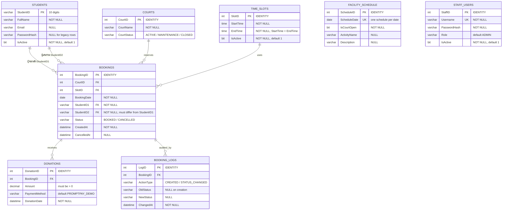

# Entity–Relationship Diagram (ERD)

ERD นี้อ้างอิงโครงสร้างจริงใน `database/02_CreateTables.sql` และการเพิ่ม `PasswordHash` ใน `database/10_AddStudentAuth.sql` ระบบมี 8 ตารางหลัก ใช้ SQL Server และเก็บการจองที่ยกเลิกไว้เพื่อรักษาประวัติ

## กฎความสัมพันธ์และข้อกำหนด

- `BOOKINGS` อ้างถึง `STUDENTS` สองครั้งเพื่อระบุผู้จองหลักและผู้เล่นร่วม ผู้จองหลักมาจากบัญชีที่เข้าสู่ระบบ ส่วนผู้เล่นร่วมต้องเป็นนิสิตที่ active เช่นกัน
- `FACILITY_SCHEDULE.ScheduleDate` ไม่ได้เป็น Foreign Key ของ `BOOKINGS.BookingDate`; ระบบตรวจว่ามีตารางเปิดสนามสำหรับวันที่นั้นภายใน View/Function/Stored Procedure ก่อนสร้างรายการจอง วันที่ไม่มี schedule ถือว่าปิด
- `DONATIONS` และ `BOOKING_LOGS` เป็นข้อมูลลูกของการจอง การยกเลิกปรับ `BOOKINGS.Status` เป็น `CANCELLED` และเก็บ audit ไว้ ไม่มีการลบรายการจองทิ้งจาก flow ปกติ
- `STAFF_USERS` เป็นบัญชีแอดมินแยกจาก `STUDENTS` ไม่มีความสัมพันธ์กับรายการจอง
- Filtered unique index บน `(CourtID, BookingDate, SlotID)` เฉพาะ `Status='BOOKED'` ทำให้คอร์ดเดียวกันในวันและช่วงเวลาเดียวกันมีรายการ active ได้เพียงรายการเดียว

## การออกแบบเชิงสัมพันธ์

แยกนิสิต คอร์ด ช่วงเวลา การจอง และเงินสนับสนุนออกจากกันเพื่อลดข้อมูลซ้ำ ชื่อคอร์ด ช่วงเวลา และชื่อนิสิตดึงด้วย JOIN เมื่อต้องแสดงผล ผู้เล่นสองคนเก็บในคอลัมน์บทบาท `StudentID1` และ `StudentID2` ตามขอบเขตระบบที่กำหนดให้มีสองคนต่อการจอง
