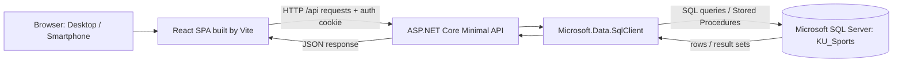

# Technology Stack

ระบบเลือกใช้เทคโนโลยีที่เชื่อมกับ Microsoft SQL Server ได้โดยตรง และทำให้ frontend, backend และฐานข้อมูลแยกหน้าที่กันชัดเจน เหมาะกับการสาธิตแนวคิด Database System

| ชั้นระบบ | เทคโนโลยี | ใช้ทำอะไร |
|---|---|---|
| Frontend | React 19, JavaScript (ES Modules), Vite 6 | SPA สำหรับสมัคร/login, เลือกวันและสนาม, จอง, ประวัติ, ทิป และหน้าจอ Admin |
| UI / Responsive | CSS ที่เขียนในโปรเจกต์, Lucide React | mobile-first layout, responsive breakpoints และไอคอน |
| Development proxy / build | Vite | ระหว่างพัฒนา proxy `/api` ไป backend; build frontend ไปที่ `backend/wwwroot` |
| Backend API | ASP.NET Core 10 Minimal API (C#) | REST endpoints, validation, cookie authentication, authorization ตาม role และเสิร์ฟ static frontend |
| SQL access | Microsoft.Data.SqlClient 7 | เชื่อมต่อ SQL Server โดยใช้ parameterized queries และเรียก Stored Procedures |
| Database | Microsoft SQL Server 2019+ | ตารางสัมพันธ์, constraint, View, Function, Stored Procedure, Trigger, transaction, locking และ indexes |
| Database tools | SQL Server Management Studio (SSMS) หรือ `sqlcmd` | สร้างฐานข้อมูล/ตาราง รัน setup scripts และตรวจข้อมูลระหว่างเดโม |
| Authentication | ASP.NET Core cookie authentication + PBKDF2-SHA256 password hashing | แยก session นิสิตกับ Admin role; ไม่เก็บ password เป็นข้อความปกติ |
| Automated verification | Node.js 22+, Playwright, integration scripts | ทดสอบ API/SQL booking flow, concurrency และ responsive UI |
| Local startup | PowerShell `Start-Demo.ps1` | เตรียม config/build/database และเริ่ม backend เพื่อใช้งานเว็บไซต์ |

## สถาปัตยกรรมการทำงาน

## เหตุผลที่เลือก

- SQL Server เป็นฐานข้อมูลหลักของงาน และเขียนโปรแกรมฐานข้อมูลด้วย T-SQL ได้โดยตรง ทั้ง View, Function, Stored Procedure, Trigger, Transaction, locking และ index
- ASP.NET Core ทำ API และการเชื่อม SQL Server ใน backend เดียวกันได้ ส่วน React/Vite ทำ UI responsive และเรียก API ผ่าน HTTP
- ในโหมดเดโม frontend build ถูกเสิร์ฟจาก backend origin เดียวกัน ลดขั้นตอนเปิดหลาย service; โหมดพัฒนายังแยก Vite dev server ที่ port 5173 กับ API ที่ port 5080 ได้
- UI ไม่เชื่อถือผลตรวจความว่างจาก browser เพียงอย่างเดียว การสร้างการจองตรวจซ้ำและป้องกันการแข่งขันที่ฐานข้อมูลใน transaction

## การตั้งค่าและการติดตั้ง

- Connection string อ่านจาก `ConnectionStrings__SqlServer` หรือ local appsettings ที่ไม่ commit
- `Start-Demo.ps1` ใช้ Windows Authentication ตามการตั้งค่าเครื่อง; ตั้ง `-Server` เพื่อเลือก named instance
- รัน SQL setup ด้วย SSMS/`sqlcmd`; ลำดับไฟล์และคำสั่งเริ่มระบบอยู่ใน `README.md`
- ไม่มีการเชื่อม KU SSO หรือ payment gateway จริง; การสมัครและทิปเป็นความสามารถเดโมภายในระบบ
